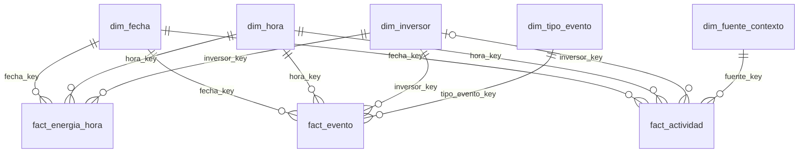

# 2 · Negocio, indicadores, modelo dimensional y diccionario de datos

## 2.1 Usuarios y preguntas de negocio (A)

| Usuario | Preguntas | Herramienta | Frecuencia |
|---|---|---|---|
| **Dirección de infraestructura** | ¿Cuánta energía aporta el sol y cuánta se compra? ¿Vale la pena más paneles o más batería? ¿Qué cargas explican el consumo? ¿Cuánto cuesta la red en COP? | Power BI | Semanal / mensual |
| **Equipo de mantenimiento** | ¿Cómo está cada inversor ahora? ¿Hay batería baja, apagado o pérdida de comunicación? | Grafana + alertas | Minuto a minuto |
| **Área de TI** | ¿El pipeline cargó completo? ¿Qué porcentaje de datos es válido? ¿Hay huecos? ¿Los servicios están sanos? | Grafana, `ops.*`, `kubectl` | Diaria / por despliegue |
| **Usuarios de las estaciones (investigadores)** | ¿Cuánta energía consume mi tarea (compilación, entrenamiento)? ¿Conviene moverla a horas de sol? | Power BI (página de cargas) | Por proyecto |

## 2.2 Catálogo de indicadores (B)

Fuente de todos: Gold (`fact_energia_hora`, `fact_evento`, `fact_actividad`). Granularidad base:
inversor × hora local, agregable a día, mes y periodo.

| Indicador | Fórmula | Unidad | Meta / umbral | Usuario |
|---|---|---|---|---|
| Energía solar generada | Σ `energia_pv_kwh` | kWh | ↑ (referencia: 3,5 kWh/kWp·día en Shenzhen) | Dirección |
| Energía entregada a la carga | Σ `energia_carga_kwh` | kWh | — (seguimiento) | Dirección |
| Energía importada de la red | Σ `energia_red_kwh` | kWh | ↓ | Dirección |
| Disponibilidad del registro | Σ `minutos_con_datos` / (horas del periodo × 60) | % | ≥ 98 % | TI |
| Datos válidos | Σ `lecturas_validas` / Σ `lecturas_recibidas` | % | ≥ 99 % | TI |
| **Fracción solar** (propio, híbrido) | solar / (solar + red) | % | ≥ 50 % | Dirección |
| **Dependencia de la red** (propio) | red / carga. Puede pasar de 100 %, porque la red también carga la batería y cubre las pérdidas | % | ≤ 50 % | Dirección |
| **Horas de sol con batería llena** (propio, híbrido) | minutos con SOC ≥ 98 % en horas de sol / minutos con datos en horas de sol | % | ≤ 20 %: por encima se recorta (desperdicia) energía solar, porque no hay exportación | Dirección |
| **Ciclos equivalentes de batería** (propio, híbrido) | Σ `energia_bat_desc_kwh` / 10,24 kWh / días | ciclos/día | 0,5–1 (LiFePO4 admite 1 diario) | Dirección |
| **Pérdidas de conversión** (propio) | (solar + red + descarga − carga de batería − consumo) / entradas | % | ≤ 10 % | Mantenimiento |
| Rendimiento específico | solar / (kWp × días) | kWh/kWp·día | ≥ 3 | Dirección |
| **Energía por versión de configuración** (propio) | indicadores anteriores agrupados por `dim_inversor` (SCD2) | — | Compara SBU frente a SOL | Dirección, mantenimiento |
| Eventos operativos | Σ `cantidad` por tipo · horas en evento (detectados + reportados por el inversor) | n · h | 0 críticos | Mantenimiento |
| Horas de operación aislada | Σ duración de `CORTE_RED` | h | — (resiliencia) | Dirección |
| **Costo de la red** (económico) | red × tarifa | COP | ↓ | Dirección |
| **Ahorro por energía solar** (económico) | solar × tarifa | COP | ↑ | Dirección |

**Tarifa:** **930 COP/kWh**, configurable en `TARIFA_COP_KWH` y con parámetro what-if en
Power BI entre 700 y 1 300. Se deduce del costo unitario de EPM en Medellín: el estrato 3 pagó
790,49 COP/kWh en la facturación de diciembre de 2025 (El Colombiano, 22/02/2026), y el estrato 3
recibe un subsidio del 15 % sobre el costo unitario que paga completo el estrato 4.
790,49 / 0,85 ≈ 930. Una universidad con tarifa comercial pagaría 20 % más (~1 116): ese es el
escenario alto del parámetro. **Verifique la tarifa vigente en epm.com.co el mes de la
entrega.**

**Resultados del periodo (base oficial, 12/07/2025 a 13/07/2026):**
- Fracción solar: 33,0 % (38,3 % en el inversor 1 y 30,0 % en el 2). Dependencia de la red: 79,2 %.
- Ciclos de batería: 0,17/día (inversor 1) y 0,31/día (inversor 2).
- Pérdidas de conversión: 23,6 % en el inversor 1 (poca carga, domina el autoconsumo del equipo) y 10,7 % en el 2.
- Rendimiento: 0,43 y 0,76 kWh/kWp·día.
- Costo de la red ≈ **4,09 M COP**; ahorro solar ≈ 2,01 M COP.

### Análisis crítico (B)

El indicador clásico que **no se puede calcular** es el **Performance Ratio (PR)**,
PR = (E_AC / P_nominal) / (H_POA / 1 kW/m²). Necesita la irradiancia en el plano del arreglo, y
la fuente no trae piranómetro ni irradiancia. Tampoco se puede calcular de forma confiable el
*capacity factor*, por dos motivos: la capacidad instalada es ambigua (6,24 o 12,48 kWp, ver
doc 1) y la energía medida está **recortada** cuando la batería está llena. Un PR bajo aquí
mezclaría mal desempeño con "no había a quién entregar la energía".

Qué haría el equipo:
1. **Corto plazo:** traer la irradiancia horaria satelital de Shenzhen (22,6° N, 114,1° E) desde
   NASA POWER u Open-Meteo, cargarla como una dimensión o hecho externo con su propia
   procedencia, y calcular un PR aproximado **solo en horas sin recorte** (SOC < 95 %).
2. **Mediano plazo:** instalar un piranómetro o una celda de referencia en el plano del arreglo
   y leerlo por Modbus junto al inversor.
3. Usar las imágenes de cielo del registro de Zenodo (`sky-*.tar.zst`) para estimar la nubosidad.

## 2.3 Modelo dimensional (C)

**Esquema elegido: estrella (constelación de 3 hechos con dimensiones conformadas).** Las
dimensiones son pequeñas (2 inversores, 24 horas, ~800 fechas). Normalizarlas en copo de nieve
no ahorra espacio y sí agrega joins en Power BI, que trabaja mejor con estrellas (relaciones 1:*
directas y un filtro por dimensión).

### Grano de cada hecho (hay 3 procesos de negocio)

| Hecho | Proceso | Grano | Tipo |
|---|---|---|---|
| `gold.fact_energia_hora` | Balance energético | **1 fila por inversor y hora local del sitio**, densificada: existe aunque no haya datos (`minutos_con_datos = 0`) | Instantánea periódica (aditiva salvo SOC) |
| `gold.fact_evento` | Eventos operativos | **1 fila por evento**: un intervalo continuo en que se cumple una condición (detectado por el ETL) o una falla registrada por el inversor (`fault_history`) | Transaccional (de acumulación: inicio/fin) |
| `gold.fact_actividad` | Actividad de las cargas (contexto) | **1 fila por registro de contexto** (tarea, anotación o evento del calendario) | Transaccional |

### Dimensiones y jerarquías

| Dimensión | Atributos clave | Jerarquía |
|---|---|---|
| `dim_fecha` | año, trimestre, mes, `anio_mes`, semana ISO, día, día de la semana, fin de semana, **festivo y evento del campus (derivados del contexto)** | Año → Trimestre → Mes → Día |
| `dim_hora` (**construida, no existe en la fuente**) | hora, **franja** (Madrugada, Mañana, Mediodía solar, Tarde, Noche), hora solar, periodo de tarifa | Franja → Hora |
| `dim_inversor` (**SCD2**) | modelo, kW nominales, kWp, kWh de batería, carga principal, **prioridad de salida y de carga, SOC de corte y de paso a la red**, vigencia | Sitio → Inversor → Versión de configuración |
| `dim_tipo_evento` | código, categoría (Operativo, Comunicación, Reportado por el inversor), severidad, regla | Categoría → Tipo |
| `dim_fuente_contexto` | fuente, tipo (automática/manual), dispositivo | Tipo → Fuente |

`dim_hora` y los atributos de calendario de `dim_fecha` no vienen de la fuente: se construyen a
partir de la hora local del sitio y de las anotaciones manuales del contexto (feriados, exámenes).

### Eventos frente a lecturas (C)

Las lecturas son medidas continuas y aditivas en el tiempo (la energía se suma). Los eventos
(alarma, apagado, batería baja) son **intervalos con inicio, fin y duración**. Si se modelaran
como banderas en la tabla de lecturas:
- contar eventos obligaría a detectar el cambio de estado en cada consulta;
- la duración no se puede sumar sin doble conteo;
- un evento que cruza horas quedaría partido.

Por eso van en su propia tabla de hechos, detectados una sola vez en el ETL con *gaps and
islands* (funciones de ventana `LAG` + `SUM OVER`). Así responden "¿cuántos?", "¿cuánto duraron?"
y "¿cuál fue el peor valor?" directamente.

### Matriz de bus (C)

| Proceso de negocio | dim_fecha | dim_hora | dim_inversor | dim_tipo_evento | dim_fuente_contexto |
|---|:-:|:-:|:-:|:-:|:-:|
| Balance energético (`fact_energia_hora`) | ✔ | ✔ | ✔ | | |
| Eventos operativos (`fact_evento`: detectados + `fault_history`) | ✔ | ✔ | ✔ | ✔ | |
| Actividad de las cargas (`fact_actividad`) | ✔ | ✔ | ✔ (opcional) | | ✔ |

### Bonificación: dimensión de cambio lento (implementada con datos reales)

`dim_inversor` es **SCD tipo 2**, y su historial **no es supuesto: sale de la fuente**. La tabla
`settings` registra la configuración del inversor cada ~12 s, y esa configuración cambió durante
el año:

| inversor_key | Inversor | Prioridad de salida | Prioridad de carga | Vigente desde | Vigente hasta | Actual |
|---:|---:|---|---|---|---|:-:|
| 1 | 1 | 2 · SBU: solar, batería, red | 2 · Híbrida (solar + red) | (inicio) | 28/08/2025 | |
| 2 | 1 | 0 · SOL: solar, luego red | 2 · Híbrida (solar + red) | 29/08/2025 | 06/01/2026 | |
| 3 | 1 | 0 · SOL: solar, luego red | 3 · Solo solar | 07/01/2026 | 9999-12-31 | ✔ |
| 4 | 2 | 0 · SOL: solar, luego red | 2 · Híbrida (solar + red) | (inicio) | 06/01/2026 | |
| 5 | 2 | 0 · SOL: solar, luego red | 3 · Solo solar | 07/01/2026 | 9999-12-31 | ✔ |

Con un tipo 1 (sobrescribir) toda la historia aparecería como "SOL / solo solar" y se perdería la
explicación de por qué la dependencia de la red del inversor 1 saltó de 0 % a 108 % y luego bajó
a 66 % (ver doc 1, §1.5). Implementación:
- clave sustituta `inversor_key` y clave natural `inversor_id`;
- `vigente_desde`, `vigente_hasta` y `es_actual`;
- los hechos se enlazan con la versión cuyo rango contiene su fecha;
- el ETL (S1–S2) descarta lecturas incompletas y toma la configuración más frecuente de cada día, para no abrir versiones por un registro mal leído.

## 2.4 Diccionario de datos (D)

### Unidades: deducidas de los datos y confirmadas con el diccionario oficial (`column_dictionary.csv`)

| Variable fuente | Unidad | Evidencia |
|---|---|---|
| `read_ts` | s desde 1970 (UTC), fraccionario | El pico solar promedio cae a las 02–03 UTC = 10–11 h en Shenzhen (UTC+8). Diccionario: "fractional Unix timestamp in UTC" |
| `statistics.*today` / `*total` | kWh | Su Δ mensual coincide con la potencia integrada dentro de ±1 % (doc 1, §1.7) |
| `settings.batstopsoc`, `inv2linesoc` | % | 5 % y 10 %: coinciden con el SOC mínimo observado (6 %) |
| `battvolt` | V | 51,4–56,4 V (p1–p99): banco LiFePO4 de 51,2 V nominales |
| `battcurr` | A, **+ descarga / − carga** | Correlación −0,78 con `battchgpower`; −66 a +54 A. El diccionario oficial lo confirma: "positive denotes discharge" |
| `battsoc` | % | Entero 10–100 |
| `pv1power`, `outw_a`, `linepowerw_a` | W | `pv1power` ≈ `pv1volt` × `pv1curr` (razón 0,999); máximos de 3–5 kW frente a 8 kW nominales |
| `outva_a` | VA | ≥ `outw_a` siempre (factor de potencia 0,81–0,92) |
| `pv1volt`, `outvolta`, `linevolta` | V | 230–240 V en AC (red china de 220/230 V); 0–490 V en DC del arreglo |
| `linefreq`, `outfreq` | Hz | 49,92–50,07 |
| `temper1..3` | °C | 10–61, con ciclo diario; `temper4` = 120 constante (sensor ausente) |

### `silver.lectura_1min` (grano: inversor × minuto UTC)

| Columna | Tipo | Llave | Regla de transformación | Origen (linaje) |
|---|---|---|---|---|
| ts | timestamptz | PK | `floor(read_ts/60)*60` → UTC | `analog_measurements.read_ts` |
| inversor_id | smallint | PK | R4: ∈ {1,2} | `inverter` |
| origen | varchar(10) | | 'historico' (ETL) / 'simulador' | — |
| n_recibidas / n_lecturas | smallint | | lecturas únicas / válidas en el minuto (R1–R6) | conteo |
| segundos_cubiertos | numeric | | Σ Δt de las válidas (R7) | `read_ts` |
| soc_pct / soc_min_pct | numeric | | último / mínimo del minuto | `battsoc` |
| bat_voltaje_v | numeric | | promedio | `battvolt` |
| bat_corriente_a | numeric | | R2 (uint16 → con signo), promedio | `battcurr` |
| bat_potencia_w | numeric | | V × I, promedio | `battvolt`, `battcurr` |
| pv_potencia_w | numeric | | promedio de válidas | `pv1power` |
| carga_potencia_w / carga_max_w | numeric | | promedio / máximo | `outw_a` |
| red_potencia_w | numeric | | promedio; R6 descarta 65 531 W | `linepowerw_a` |
| salida_voltaje_v · red_voltaje_v · red_frecuencia_hz | numeric | | promedio | `outvolta`, `linevolta`, `linefreq` |
| temp_inversor_c | numeric | | promedio | `temper3` |
| *_energia_wh | numeric | | Σ P × Δt / 3600 de las válidas | potencias + `read_ts` |

### `silver.config_inversor` y `silver.falla_inversor`

| Tabla | Columna | Tipo | Llave | Regla | Origen |
|---|---|---|---|---|---|
| config_inversor | inversor_id, vigente_desde | smallint, date | PK | S1–S2: moda diaria, versión nueva cuando cambia una prioridad | `settings.inverter`, `read_ts` |
| config_inversor | prioridad_salida, prioridad_carga | smallint | | código original | `outpriority`, `chgpriority` |
| config_inversor | soc_corte_pct, soc_paso_a_red_pct, soc_lleno_pct | smallint | | — | `batstopsoc`, `inv2linesoc`, `battfullsoc` |
| falla_inversor | inversor_id, ts, codigo | smallint, timestamptz, smallint | PK | F1: distintas por (inversor, código, hora) | `fault_history.faulthistoryrecordNN[0]`, `…_time` |
| falla_inversor | carga | jsonb | | arreglo original de 16 registros | `faulthistoryrecordNN` |

### `silver.contexto`

| Columna | Tipo | Llave | Regla | Origen |
|---|---|---|---|---|
| contexto_id | integer | PK | C1 dedup | `context.id` |
| registrado_ts / inicio_ts / fin_ts | timestamptz | | época → UTC; C4 fin ≥ inicio | `recorded`, `start`, `end` |
| inversor_id | smallint | | `value->>'inverter'`; NULL = todo el sitio | `value` |
| fuente | varchar | | `value->>'source'` | `value` |
| valor | **jsonb** | GIN | C2 JSON válido; C3 rutas enmascaradas | `value` |

### Gold

| Tabla | Columna | Tipo | Llave | Regla / linaje |
|---|---|---|---|---|
| dim_fecha | fecha_key | int | PK | AAAAMMDD de la fecha local (Asia/Shanghai) |
| dim_fecha | es_festivo, evento_campus | bool, text | | contexto `manual entry` sin inversor con "holiday/festival" |
| dim_hora | hora_key | smallint | PK | 0–23; franja y periodo de tarifa construidos |
| dim_inversor | inversor_key | smallint | PK (sustituta) | `inversor_id` natural + vigencia SCD2 desde `silver.config_inversor` |
| dim_inversor | prioridad_salida(_texto), prioridad_carga(_texto) | smallint, varchar | | código + interpretación verificada con el comportamiento |
| dim_tipo_evento | tipo_evento_key | smallint | PK | catálogo con la regla que dispara cada evento |
| dim_fuente_contexto | fuente_key | smallint | PK | `DISTINCT silver.contexto.fuente` |
| fact_energia_hora | fecha_key, hora_key, inversor_key | | PK compuesta + FK | Σ de `silver.lectura_1min` por hora local, densificada |
| fact_energia_hora | energia_*_kwh | numeric(10,4) | | Σ Wh / 1000 |
| fact_energia_hora | minutos_con_datos, minutos_soc_lleno | smallint | | conteos de minutos |
| fact_energia_hora | lecturas_validas / recibidas / esperadas | int | | Σ n_lecturas / Σ n_recibidas / 3600 ÷ 12 |
| fact_evento | evento_id | bigint | PK | `row_number()` determinista |
| fact_evento | tipo_evento_key … duracion_min, valor_extremo | | FK | islas de minutos que cumplen la regla, más las fallas de `silver.falla_inversor` (duración 0) |
| fact_actividad | contexto_id | int | PK | 1 por registro de contexto |
| fact_actividad | tipo_tarea | varchar(60) | | `valor->>'context_type'` (p. ej. `gpu_cnn_training_workload`) |
| fact_actividad | carga_prom_w, energia_carga_kwh | numeric | | carga medida en `silver.lectura_1min` entre inicio y fin |

## 2.5 Restricciones e índices (F)

| Objeto | Por qué |
|---|---|
| PK `(inversor_id, ts)` en Silver | Unicidad del grano. También sirve para "último valor por inversor" (`DISTINCT ON … ORDER BY ts DESC`), que usan Grafana y las alertas cada minuto |
| **BRIN** sobre `ts` | Los datos llegan en orden temporal y Grafana siempre filtra por rango: un BRIN pesa KB, frente a decenas de MB de un B-tree |
| **GIN `jsonb_path_ops`** sobre `contexto.valor` | Acelera las consultas por contención `@>` (p. ej. `'{"inverter": 1}'`) |
| CHECK de rangos (SOC 0–100, potencias ≥ 0, `fin ≥ inicio`) | Última barrera: si una regla del ETL falla, la base rechaza el dato |
| FK de hechos a dimensiones | Integridad referencial que Power BI asume al crear relaciones |
| `ix_feh_inversor_fecha`, `ix_fe_tipo_fecha`, `ix_fa_fecha` | Filtros típicos de Power BI (inversor + rango de fechas, tipo de evento) |
