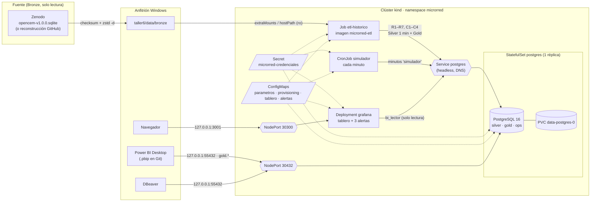

# 4 · Arquitectura, análisis comparativo, ética y seguridad (I, J)

## 4.1 Arquitectura completa (I)

La versión en imagen está en `docs/informe/capturas/arquitectura.png`.

## 4.2 Power BI frente a Grafana (I)

| | **Grafana** (operativo) | **Power BI** (analítico) |
|---|---|---|
| Pregunta | "¿Qué está pasando ahora y hay que actuar?" | "¿Qué pasó, por qué y qué conviene decidir?" |
| Usuario | Mantenimiento, TI | Dirección de infraestructura, investigadores |
| Datos | `silver.lectura_1min` (histórico + simulador), último minuto | `gold.*` (modelo estrella, solo histórico conciliado) |
| Actualización | Cada 30 s; alertas evaluadas cada minuto | Programada (diaria/semanal) o manual; modo Import |
| Fortaleza | Series de tiempo largas, estado actual, alertas con umbral y notificación | Medidas DAX, inteligencia de tiempo, what-if, drill-down, narrativa |
| Por qué no se intercambian | Grafana no tiene un modelo semántico (relaciones, jerarquías, DAX) ni escenarios what-if: comparar meses o simular una tarifa sería SQL a mano en cada panel | Power BI no está hecho para refrescar cada minuto ni para disparar alertas operativas. Un tablero de decisiones que cambia cada 30 s con datos sin conciliar confunde |

## 4.3 Evolución: datos directos desde Modbus o un SCADA (I)

1. **Adquisición en el borde:** un *gateway* (Raspberry Pi o PLC) lee los inversores por
   Modbus RTU/RS485 cada 10–15 s y publica en **MQTT** (Mosquitto o EMQX en el clúster), con QoS 1
   y un búfer local si cae la red. Si existe un SCADA, se consume por **OPC UA** en lugar de
   Modbus.
2. **Ingesta en streaming:** un Deployment consumidor (o Kafka Connect / Telegraf) valida cada
   mensaje con las mismas reglas R2–R6 y escribe en una tabla cruda particionada por día. Una
   alternativa es **TimescaleDB** (extensión de PostgreSQL): *hypertables* y *continuous
   aggregates* reemplazan el agregado a 1 minuto.
3. **Silver y Gold incrementales:** el Job histórico pasa a ser un CronJob horario que procesa
   solo la última ventana (*watermark*) con `INSERT … ON CONFLICT`. Gold se refresca por hora.
4. **Cambia la frontera de calidad:** el desborde uint16 se corrige al decodificar el registro
   (tipo `int16`, factor de escala 0,1). Los huecos se detectan por *heartbeat* MQTT, sin esperar
   al ETL.
5. **Control (bidireccional):** el artículo indica que Modbus también acepta consignas. Cambiar
   la prioridad de fuentes a SBU desde el sistema exigiría autenticación, auditoría y aprobación
   humana, porque un error deja sin energía a las cargas.

## 4.4 Tratamiento de la tabla de contexto según la Ley 1581 de 2012 (J)

La Ley 1581 protege los **datos personales**: información vinculada o que pueda asociarse a
personas naturales determinadas o determinables. El contexto (25 178 registros) describe lo que
hacían las **personas** del laboratorio con los equipos: compilaciones, entrenamientos de redes
neuronales, inicios de sesión remota, historial de comandos y anotaciones manuales. Aunque el
dataset ya pasó una revisión de privacidad de sus autores, sigue permitiendo inferir horarios y
hábitos de trabajo de personas identificables del equipo.

| Campo | Riesgo | Tratamiento aplicado |
|---|---|---|
| `textual_description`, `summary` | Pueden describir actividades y planes de una persona ("Tomorrow I will run…") | Se conservan en Silver con acceso restringido. En Gold y Power BI solo queda el **tipo** de actividad (`context_type`) |
| `command`, `directory`, `example_commands_redacted` | Pueden contener el usuario del sistema y rutas personales | Llegan seudonimizados por la fuente (`/home/<user>`). El ETL aplica además la regla C3 (`/home/<usuario>`, `C:\Users\<usuario>`) por si una versión futura no lo hiciera |
| `windows_event` (inicios de sesión, escritorio remoto) | Revela **cuándo** estuvo conectada una persona | Solo se usa agregado (conteos por franja); no se publica el detalle |
| `device` (workstation1/2), `inverter` | Equipo, no persona | Se conserva |
| Calendario del campus (feriados, exámenes) | Información pública | Se conserva y enriquece `dim_fecha` |

Principios de la ley aplicados:
- **Finalidad:** el contexto se usa solo para explicar el consumo energético. No sirve para medir la productividad ni vigilar la conexión de las personas.
- **Acceso y circulación restringida:** Power BI y Grafana usan `bi_lector` sobre Gold y la operación. El informe no muestra textos libres ni comandos.
- **Seguridad:** credenciales en un Secret, nada en Git (ver 4.5).
- **Libertad / autorización:** los datos se publican bajo CC BY 4.0, pero esa licencia no reemplaza la autorización de los titulares. Si el sistema se replicara con personas reales del Pascual Bravo, habría que pedir su consentimiento informado, publicar una política de tratamiento y registrar la base ante la SIC si aplica.
- **Minimización:** de 60 llaves distintas del JSON, Gold usa 4 (`inverter`, `source`, `context_type`, `llm_estimated_task_effort`).

## 4.5 Seguridad de acceso y credenciales (J)

| Capa | Medida |
|---|---|
| Repositorio | `credenciales.env` en `.gitignore`; solo se versionan `credenciales.env.example` y `secret.example.yaml` |
| Clúster | Contraseñas en el Secret `microrred-credenciales` (inyectadas como variables de entorno). Grafana recibe **solo** las llaves que necesita (`secretKeyRef`), no la clave del dueño de la base |
| Base de datos | Dos roles: `microrred` (dueño, solo lo usan el ETL y el simulador) y **`bi_lector`** (solo `SELECT` en silver, gold y ops) para Grafana, Power BI y DBeaver. `REVOKE CREATE ON SCHEMA public` |
| Red | PostgreSQL y Grafana se publican solo en `127.0.0.1` (no en la LAN). Dentro del clúster se usa el DNS del Service |
| Grafana | Sin acceso anónimo ni registro de usuarios; administrador con la clave del Secret; tablero y alertas no editables desde la interfaz (`allowUiUpdates: false`) |
| Contenedores propios | Corren como usuario no root (UID 10001) |
| Pendiente en producción | Secrets cifrados en etcd o un gestor externo (Vault, Sealed Secrets), TLS en PostgreSQL y Grafana detrás de un Ingress con HTTPS, y NetworkPolicies para que solo Grafana, el ETL y el simulador hablen con PostgreSQL |

## 4.6 Hallazgos y recomendaciones para la dirección (data storytelling)

1. **Un cambio de configuración convirtió las baterías en un adorno caro.** El 29/08/2025 el
   inversor 1 pasó de prioridad de salida **SBU** (sol → batería → red) a **SOL** (sol → red).
   Antes, la red aportó **0 %** del consumo. Después aportó el **108 %**: la red alimentó la carga
   de noche y además cargó la batería, que pasó llena el 84 % del tiempo de 10:00 a 15:00. Cuando
   el 07/01/2026 se cambió la carga a "solo solar", la dependencia bajó a 66 %, pero la salida
   sigue en SOL. **Recomendación:** volver a **SBU** en ambos inversores. No requiere inversión y
   las baterías hoy hacen apenas 0,17 y 0,31 ciclos por día, frente a 1 que tolera una LiFePO4.
2. **Se desperdicia energía solar.** Sin exportación a la red, con la batería llena el inversor
   recorta el arreglo. El rendimiento fue de 0,43 y 0,76 kWh/kWp·día, frente a ~3,5 esperables
   en Shenzhen. **No compren más paneles** hasta resolver el punto 1.
3. **La red pública falla, y la planta resiste.** Hubo 24 cortes de red (hasta 17 días seguidos
   en el inversor 1); en esos periodos el sol y la batería sostuvieron la carga. Es el mejor
   argumento de resiliencia para la inversión que ya se hizo.
4. **Hay que mover cargas flexibles al mediodía.** El contexto registra 2 955 entrenamientos de
   redes neuronales (`gpu_cnn_training_workload`) y 11 974 compilaciones. Programarlos en la
   franja "Mediodía solar" sube la fracción solar (hoy 33 %).
5. **El monitoreo tenía puntos ciegos.** Hubo 153 huecos de más de 10 min y uno de 26 días que
   nadie vio. La alerta "Inversor sin datos" (> 5 min) lo detecta en minutos.
6. **El inversor 2 (aire acondicionado) es el que más sufre:** 15 eventos de batería baja (hasta
   19 h por debajo del 20 %) y 39 apagados de salida. Además consume un **45 % más en días
   festivos** que en días laborales (19,1 frente a 13,2 kWh/día), lo que sugiere cargas
   encendidas sin ocupación. Conviene revisar un **horario de apagado** antes de pensar en más
   batería.
